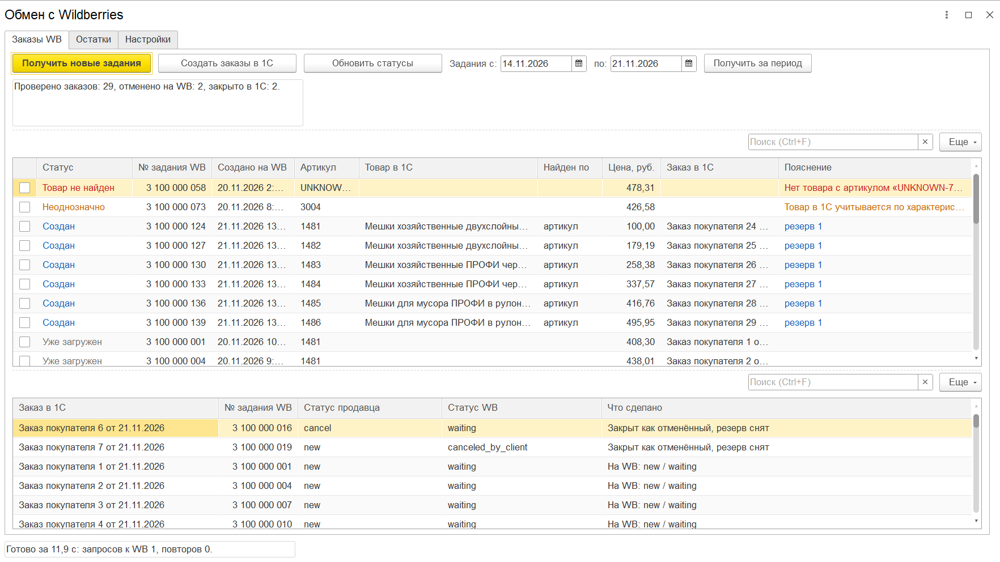
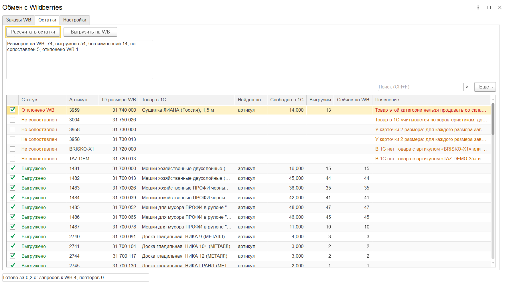
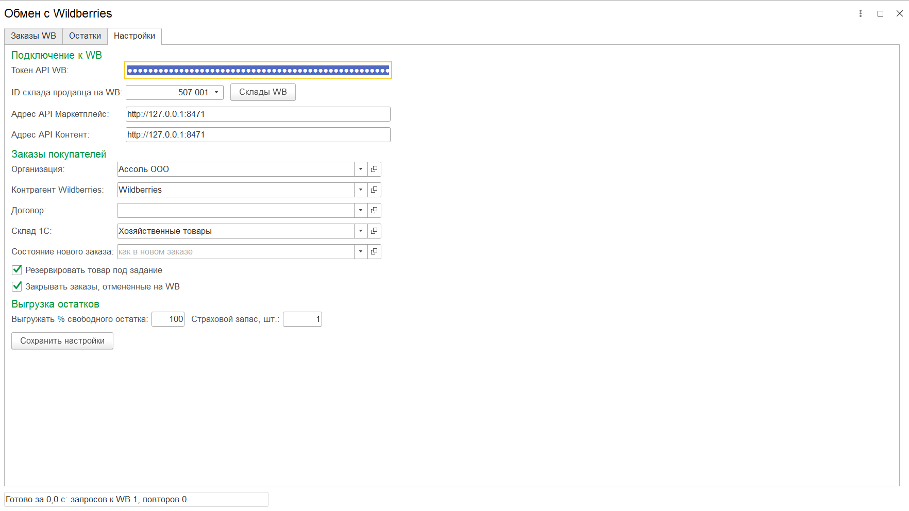

# Обмен 1С:УНФ с Wildberries: заказы FBS, отмены и остатки

Продавец, который отгружает Wildberries со своего склада (модель FBS), каждый день делает одно и то же: переносит новые сборочные задания из кабинета WB в 1С, следит за отменами и обновляет остатки на WB. Если остаток на WB разошёлся со складом, покупатель закажет товар, которого нет, и задание придётся отменять. Обработка забирает задания и создаёт по ним заказы покупателей с резервом, закрывает в 1С заказы, отменённые на WB, выгружает свободный остаток и потом проверяет, что WB его действительно принял.



Показано на демобазе «1С:Управление нашей фирмой 3.0»: товары склада «Хозяйственные товары» и организация «Ассоль ООО» из этой базы. Песочницы для FBS у WB нет, поэтому вместо кабинета работает мок API, собранный по документации dev.wildberries.ru. Карточки, задания и остатки на стороне WB сгенерированы скриптом `samples/make_fixtures.js` из товаров демобазы и не относятся к какому-либо продавцу.

## Что делает

1. Забирает новые сборочные задания и ищет товар в 1С: сначала по штрихкоду WB, затем по артикулу продавца. По каждому заданию создаёт «Заказ покупателя» на контрагента Wildberries с резервом на складе из настроек. Номер задания пишется в «Номер входящего документа», комментарий покупателя попадает в комментарий заказа, ставка НДС берётся из настроек организации.
2. Каждый заказ пишется в своей транзакции, ошибка в одном задании не останавливает остальные. Если свободного остатка нет, заказ всё равно создаётся, только без резерва и с пометкой: задание WB надо собрать или отменить в срок.
3. Проверяет статусы загруженных заданий. Когда задание отменил продавец, покупатель или WB, заказ в 1С закрывается с вариантом «Отменен», резерв снимается, и товар снова доступен для продажи.
4. Считает остаток к выгрузке: свободный остаток склада без резервов под заказы, процент от остатка и страховой запас. Сравнивает с тем, что уже стоит на складе продавца WB, и отправляет только изменения.
5. После отправки перечитывает остатки на WB. Статус «Выгружено» строка получает только тогда, когда WB вернул отправленное число.
6. Пишет итоги и ошибки в журнал регистрации. Токен WB хранится в безопасном хранилище БСП, в обычные настройки он не попадает.

## Где такие обмены обычно ломаются

| Что бывает в жизни | Что делает обработка |
|---|---|
| WB ответил 204 на выгрузку остатков, а остаток не изменился. В документации WB прямо предупреждает: если поле в запросе названо неверно, придёт 204 и ничего не обновится | Каждая отправленная позиция перечитывается. Если на WB другое число, строка получает «Не подтверждено» и пояснение вида «на складе 18 вместо 17» |
| С 20.05.2026 WB принимает остатки только по chrtId, запрос со старым полем sku получает 400 | Остатки уходят по chrtId, его обработка берёт из карточек WB |
| Лимит 300 запросов в минуту на маркетплейс и 80 на контент, ответ с ошибкой 4XX WB считает за 10 запросов | Обработка следит за заголовком X-Ratelimit-Remaining и сама держит интервал из документации. Если WB всё же вернул 429, ждёт столько секунд, сколько он указал в X-Ratelimit-Retry |
| WB отвечает 500 или 503, обрывается связь | Повтор с растущей паузой: 1, 2, 4 секунды и дальше, но не больше 30. После заданного числа попыток понятная ошибка «WB не ответил после 6 попыток» |
| Склад продавца на WB в эту минуту обновляется (409 StoreIsProcessing) | Та же пачка уходит повторно через 3 секунды |
| Покупатель отказался от заказа, или WB отменил задание | Заказ в 1С закрывается как отменённый, резерв снимается. Закрытые заказы больше не проверяются |
| Задания загрузили второй раз: запуск по расписанию совпал с ручным | Номер задания лежит в заказе, второй заказ не создаётся. Перед записью проверка повторяется внутри транзакции |
| Товар продан в другом канале, свободного остатка в 1С нет | Заказ создаётся без резерва, пометка в строке и в комментарии заказа. С резервом УНФ такой заказ не проведёт, а задание WB ждать не будет |
| Размеры товара в 1С заведены характеристиками, а карточку WB удалось найти только по артикулу | Размер не угадывается: в строке подсказка, к какой характеристике добавить штрихкод WB. Без характеристики УНФ заказ не проведёт. Когда штрихкоды заведены, каждый размер получает остаток своей характеристики |
| У карточки WB несколько размеров, а в 1С один товар без характеристик | Остаток по размерам не делится, строка «Не сопоставлен» с объяснением |
| Товар этой категории нельзя продавать со своего склада, WB отвечает 409 SubjectRestriction | В строке этой позиции отказ по-русски, остальные позиции пачки выгружаются |
| Продажа в Беларусь или Казахстан с ценой в чужой валюте | Цена берётся из convertedPrice, в рублях |
| Заказ сделан, когда на WB был нулевой остаток (isZeroOrder) | Заказ создаётся с пометкой, что такое задание WB разрешает отменить без штрафа |
| Токен истёк (он живёт 180 дней) или создан без нужной категории | Обработка останавливается и пишет, что сделать: выпустить новый токен или отметить категорию «Маркетплейс» |



## Как проверено

120 автоматических проверок на демобазе против мока API WB, включая прогон на 300 заданий и пакетный запуск, как из планировщика. Мок повторяет то, что описано в документации WB: форматы ответов и ошибок (текст ответа 401 взят из настоящего ответа WB), лимиты с заголовками X-Ratelimit, курсорную пагинацию карточек, отказы по отдельным позициям в ответе 409. Сбои тесты включают через служебные методы мока: 500 и 503 подряд, 429, «склад обновляется», ответ 204 без изменения остатка. Ожидаемые числа считает генератор данных по смыслу данных, отдельно от кода обработки. Отрывок отчёта:

```
Проверок: 120, пройдено: 120, не пройдено: 0.

Товар с характеристиками: размер WB только по штрихкоду
  ok    без штрихкодов WB размеры не угадываются, в строке подсказка
        Товар в 1С учитывается по характеристикам: добавьте штрихкод WB 2041000000698 к характеристике размера S
  ok    заказ на размер без штрихкода не создаётся с пустой характеристикой
  ok    со штрихкодами каждый размер нашёл свою характеристику и её остаток
Карточки по 10 на страницу: лимит WB не превышен
  ok    ответов 429: обработка держит интервал сама
  ok    после всплеска из 5 запросов ждёт по 750 мс
Склад обновляется, потом WB отвечает 204 и не меняет остаток
  ok    повтор после «склад обновляется»
  ok    первая пачка не подтверждена: WB ответил 204, но остаток прежний
  ok    в пояснении видно, что осталось на WB
Повторная загрузка тех же заданий
  ok    все найденные задания уже загружены
  ok    ничего не создано
Сбои WB: 500, 429, недоступность
  ok    паузы растут: 1 с, потом 2 с
  ok    повтор не раньше, чем просил WB в X-Ratelimit-Retry
  ok    WB недоступен: понятная ошибка после 3 попыток
Отмена на WB закрывает заказ и снимает резерв
  ok    закрыто в 1С как отменённые
  ok    резерв снят: свободный остаток вырос на 2
Объём: 300 новых заданий
  ok    новых заданий к созданию
  время: получение и сопоставление 323 заданий за 0,1 с
  ok    создано по отмеченным заданиям
  ok    ошибок
  ok    товара нет в свободном остатке: заказ создан без резерва
Пакетный запуск: обработка с параметром ЗагрузитьЗаказы, как из планировщика
  ok    создано 5 заказов по новым заданиям
```

Полный отчёт с каждой проверкой: [tests/report.txt](tests/report.txt).

Скорость на обычном ноутбуке, учебная платформа, файловая база:

| Что | Время |
|---|---|
| Получение и сопоставление 323 заданий с товарами 1С | 0,1 с |
| Создание и проведение одного заказа покупателя | от 3,5 до 4 с |
| Расчёт остатков по 74 размерам, выгрузка и сверка | меньше секунды без пауз на лимиты WB |
| Создание 300 заказов в объёмном прогоне | 300 из 300 без ошибок, 26 без резерва там, где кончился свободный остаток |

Почти всё время создания заказа уходит на запись и проведение документа в самой УНФ. Отдельный замер на той же базе: заказ без обработчиков конфигурации записывается за 33 мс, а запись с проведением занимает от 3,5 до 4 секунд. Обработка добавляет к этому доли секунды на проверку дубля и заполнения. В отчёте объёмного прогона вышло 8 секунд на заказ, потому что ноутбук в это время был занят другой работой. Для продавца с 300 заказами в день это около 20 минут работы обмена за день, а при запуске по расписанию раз в 15 минут на каждый запуск приходится по несколько заказов.

## Как подключить

1. Открыть `build/ОбменWildberries.epf` через «Файл → Открыть» или добавить в справочник «Дополнительные отчеты и обработки» (в модуле есть `СведенияОВнешнейОбработке()`).
2. На странице «Настройки» указать токен WB с категориями «Маркетплейс» и «Контент», склад 1С, организацию и контрагента Wildberries. Кнопка «Склады WB» загрузит склады продавца и подставит склад FBS. Нажать «Сохранить настройки».
3. На странице «Заказы WB»: «Получить новые задания», проверить таблицу, «Создать заказы в 1С». Отмены проверяет кнопка «Обновить статусы». На странице «Остатки»: «Рассчитать остатки», затем «Выгрузить на WB».



Для запуска по расписанию:

```
1cv8.exe ENTERPRISE /F <база> /N <пользователь> /Execute ОбменWildberries.epf /C "ЗагрузитьЗаказы;C:\Обмен\wb_заказы.txt"
```

Команды: `ЗагрузитьЗаказы` (новые задания и заказы по ним), `ОбновитьСтатусы` (закрытие отменённых), `ВыгрузитьОстатки` (расчёт, выгрузка и сверка за один проход). Настройки и токен берутся сохранённые. В отчёт попадают итог и строки, с которыми надо разобраться вручную:

```
Обмен с Wildberries, Заказы, 21.11.2026 12:54:02
Заданий WB: 30, товар не найден 1, создан 5, уже загружен 24.
  3100000058  Товар не найден  UNKNOWN-777  Нет товара с артикулом «UNKNOWN-777» или штрихкодом 2049999999993
Создано заказов: 5, уже были: 0, ошибок: 0.
```

## Устройство

* Платформа не разрешает ждать на сервере в вызове с клиента (`ВызватьПаузу` работает только в фоновых заданиях), а WB просит подождать при лимитах и сбоях. Поэтому операция идёт шагами: `ВыполнитьШаг` выполняет запросы из очереди, пока WB не попросит паузу, и возвращает, сколько ждать. Форма ждёт через обработчик ожидания, сервер не крутит пустой цикл.
* Модуль объекта делает всю работу: очередь запросов, разбор ответов, сопоставление, расчёт остатков, создание и закрытие заказов. Форма показывает результат и проблемные строки ставит наверх.
* Сопоставление пакетное: один запрос на штрихкоды и один на артикулы для всей таблицы, без запроса на каждое задание.
* БСП: безопасное хранилище для токена, прокси из настроек получения файлов из интернета, регистрация как дополнительной обработки, журнал регистрации.
* `tests/` обработка с автотестами. `tools\test.ps1 -Base <база> -Reference <копия 1Cv8.1CD> -Build` поднимает мок, восстанавливает демобазу из эталона, собирает обработки, запускает тесты, затем проверяет пакетный запуск и снова восстанавливает базу. С ключом `-Volume` создаются все 300 заказов объёмного теста.
* `tools/wb-mock.js` мок API WB на Node.js без зависимостей. Служебные методы `/__mock/*` включают сбои, лимиты, меняют статусы заданий и добавляют новые.
* `samples/` выгрузка товаров демобазы и генератор, который строит из неё карточки, задания и остатки WB и считает ожидаемый результат.
* Сборка из исходников без ручной работы в конфигураторе: `tools/build_epf.ps1`.

Проверено на «Управление нашей фирмой (учебная)» 3.0.13.251, платформа 8.5.1, файловый режим. С настоящим кабинетом WB обработка не запускалась: для этого нужен токен продавца. Запросы, ответы и коды ошибок сверены с документацией WB на 20.11.2026.

Другие работы: [загрузка прайса поставщика в УНФ](https://github.com/matbcontrol/1c-supplier-price-import) с проверкой цен до записи и [лист сборки заказов Wildberries](https://github.com/matbcontrol/1c-wb-picking-list).

## Нужна похожая интеграция?

Сделаю обмен с Wildberries, Ozon или Яндекс Маркетом под вашу конфигурацию (УНФ, УТ 11, КА, Розница): FBS и FBO, цены, несколько складов, запуск по расписанию. Telegram: @MATb_CONTROL
